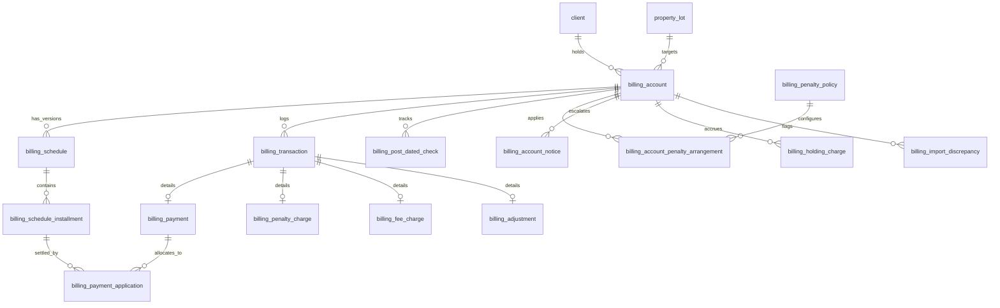
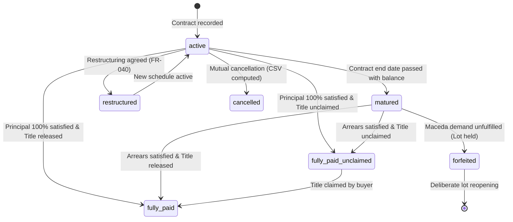

# Data Model: Billing & Ledger Rewrite

**Branch**: `002-billing-ledger-rewrite` | **Date**: 2026-11-08 | **Spec**: [spec.md](./spec.md)

This document formalizes the entity definitions, database schemas, relationships, constraints, and lifecycle transitions for the rewritten billing and accounting module.

---

## 1. Entity Overview & Architecture

The ledger architecture is **append-only, event-driven, and non-destructive**. Balances are calculated dynamically rather than stored.

---

## 2. Table Definitions

### 2.1 `billing_account`
Represents an individual buyer contract on a specific property lot. Replaces legacy stored-balance columns on `ledger_account`.

| Column | Type | Constraints | Description |
|---|---|---|---|
| `account_id` | `UUID` | `PRIMARY KEY DEFAULT gen_random_uuid()` | Unique account identifier |
| `property_id` | `UUID` | `NOT NULL REFERENCES property_lot(property_id)` | Linked lot (at most 1 live contract per lot) |
| `client_id` | `UUID` | `NOT NULL REFERENCES client(client_id)` | Principal buyer |
| `cts_number` | `VARCHAR(100)` | `NULL` | Contract to Sell reference number |
| `contract_date` | `DATE` | `NOT NULL` | Baseline contract signing date |
| `total_selling_price`| `NUMERIC(15, 2)` | `NOT NULL CHECK (total_selling_price > 0)` | Agreed total contract price in centavos |
| `amortization_day` | `INT` | `NOT NULL DEFAULT 28 CHECK (amortization_day BETWEEN 1 AND 31)` | Day of month installments are due |
| `cadence` | `VARCHAR(20)` | `NOT NULL DEFAULT 'monthly' CHECK (cadence IN ('monthly', 'quarterly', 'semi-annual', 'annual'))` | Installment cadence |
| `status` | `VARCHAR(30)` | `NOT NULL DEFAULT 'active'` | One of 7 states (see Section 3.1) |
| `baseline_date` | `DATE` | `NULL` | Cutover snapshot date for legacy migration |
| `baseline_paid` | `NUMERIC(15, 2)` | `NOT NULL DEFAULT 0.00` | Historical principal paid up to baseline |
| `baseline_penalties` | `NUMERIC(15, 2)` | `NOT NULL DEFAULT 0.00` | Historical penalties accrued up to baseline |
| `baseline_notes` | `TEXT` | `NULL` | Free-text migration/audit notes |
| `held_since` | `TIMESTAMPTZ` | `NULL` | Timestamp lot hold began (upon forfeiture) |
| `reopened_at` | `TIMESTAMPTZ` | `NULL` | Timestamp lot hold was released |
| `reopened_by` | `UUID` | `REFERENCES auth.users(id)` | Staff member who cleared documents and reopened lot |
| `created_at` | `TIMESTAMPTZ` | `NOT NULL DEFAULT CURRENT_TIMESTAMP` | Audit timestamp |
| `updated_at` | `TIMESTAMPTZ` | `NOT NULL DEFAULT CURRENT_TIMESTAMP` | Audit timestamp |

**Indexes & Invariants:**
- `UNIQUE (property_id)` WHERE `status IN ('active', 'matured', 'fully_paid', 'fully_paid_unclaimed', 'restructured', 'forfeited')` AND `reopened_at IS NULL` (ensures never selling a lot twice or having overlapping live contracts per `FR-005` and `FR-060`).

---

### 2.2 `billing_schedule` & `billing_schedule_installment`
Committed installment schedules with versioning (`FR-002`, `FR-003`, `FR-004`, `FR-040`).

#### `billing_schedule`
| Column | Type | Constraints | Description |
|---|---|---|---|
| `schedule_id` | `UUID` | `PRIMARY KEY DEFAULT gen_random_uuid()` | Schedule version identifier |
| `account_id` | `UUID` | `NOT NULL REFERENCES billing_account(account_id) ON DELETE CASCADE` | Linked account |
| `version` | `INT` | `NOT NULL DEFAULT 1` | 1 for original, incremented for restructures |
| `effective_date` | `DATE` | `NOT NULL` | Date this schedule becomes active |
| `is_active` | `BOOLEAN` | `NOT NULL DEFAULT true` | Only one schedule is active per account |
| `term_months` | `INT` | `NOT NULL CHECK (term_months > 0)` | Total number of installments |
| `reason` | `TEXT` | `NULL` | Reason if restructured or amended (`FR-038`) |
| `created_by` | `UUID` | `REFERENCES auth.users(id)` | Creator |
| `created_at` | `TIMESTAMPTZ` | `NOT NULL DEFAULT CURRENT_TIMESTAMP` | Audit timestamp |

#### `billing_schedule_installment`
| Column | Type | Constraints | Description |
|---|---|---|---|
| `installment_id` | `UUID` | `PRIMARY KEY DEFAULT gen_random_uuid()` | Installment identifier |
| `schedule_id` | `UUID` | `NOT NULL REFERENCES billing_schedule(schedule_id) ON DELETE CASCADE` | Parent schedule version |
| `installment_number` | `INT` | `NOT NULL CHECK (installment_number > 0)` | 1 to `term_months` |
| `due_date` | `DATE` | `NOT NULL` | Due date for this installment |
| `amount` | `NUMERIC(15, 2)` | `NOT NULL CHECK (amount > 0)` | Scheduled installment amount (rounded to centavos) |

**Constraint Check:**
Sum of `amount` across all installments in a schedule must match the scheduled balance to the centavo (`FR-003`, `SC-009`). Any rounding residue is absorbed into `installment_number = term_months`.

---

### 2.3 `billing_transaction` (The Append-Only Journal)
Core append-only journal (`FR-011`, `FR-012`, `FR-013`, `FR-014`).

| Column | Type | Constraints | Description |
|---|---|---|---|
| `transaction_id` | `UUID` | `PRIMARY KEY DEFAULT gen_random_uuid()` | Unique transaction ID |
| `account_id` | `UUID` | `NOT NULL REFERENCES billing_account(account_id) ON DELETE RESTRICT` | Target account |
| `transaction_sequence` | `BIGINT` | `NOT NULL` | Monotonically increasing sequence number per account |
| `transaction_type` | `VARCHAR(30)` | `NOT NULL CHECK (transaction_type IN ('payment', 'penalty_charge', 'fee_charge', 'adjustment', 'reversal'))` | Transaction category |
| `value_date` | `DATE` | `NOT NULL` | Financial effective date (supports backdated posting per `FR-001`) |
| `amount` | `NUMERIC(15, 2)` | `NOT NULL` | Signed or unsigned amount (rounded to 2 decimals) |
| `reverses_transaction_id` | `UUID` | `REFERENCES billing_transaction(transaction_id)` | Link if this is a reversal |
| `is_reversed` | `BOOLEAN` | `NOT NULL DEFAULT false` | Flag indicating this transaction was reversed |
| `posted_by` | `UUID` | `NOT NULL REFERENCES auth.users(id)` | Authenticated staff member who posted entry |
| `remarks` | `TEXT` | `NULL` | Transaction remarks / justification |
| `created_at` | `TIMESTAMPTZ` | `NOT NULL DEFAULT CURRENT_TIMESTAMP` | Server insert timestamp |

**Invariants:**
- `UNIQUE (account_id, transaction_sequence)` ensures no sequence collisions under concurrency (`FR-013`, `SC-008`).
- A transaction cannot be reversed twice (`FR-012`).
- A reversal transaction cannot be reversed (`FR-012`).

---

### 2.4 `billing_payment` & `billing_payment_application`
Detailed payment capture and contract waterfall allocation (`FR-015`, `FR-016`, `FR-017`, `FR-018`, `FR-020`, `FR-021`).

#### `billing_payment`
| Column | Type | Constraints | Description |
|---|---|---|---|
| `payment_id` | `UUID` | `PRIMARY KEY DEFAULT gen_random_uuid()` | Payment ID |
| `transaction_id` | `UUID` | `NOT NULL UNIQUE REFERENCES billing_transaction(transaction_id) ON DELETE CASCADE` | Linked journal transaction |
| `or_series` | `VARCHAR(50)` | `NOT NULL DEFAULT 'Main'` | Receipt number series |
| `or_number` | `VARCHAR(100)` | `NOT NULL` | Official Receipt number |
| `payment_mode` | `VARCHAR(50)` | `NOT NULL CHECK (payment_mode IN ('Cash', 'Check', 'Bank Transfer', 'Online Deposit'))` | Payment method |
| `total_received` | `NUMERIC(15, 2)` | `NOT NULL CHECK (total_received > 0)` | Total money received |
| `receipt_attachment_id` | `UUID` | `REFERENCES file_attachment(attachment_id)` | Optional scan of physical receipt |
| `is_historical_split` | `BOOLEAN` | `NOT NULL DEFAULT false` | True if preserving legacy workbook split |

#### `billing_payment_application`
| Column | Type | Constraints | Description |
|---|---|---|---|
| `application_id` | `UUID` | `PRIMARY KEY DEFAULT gen_random_uuid()` | Application ID |
| `payment_id` | `UUID` | `NOT NULL REFERENCES billing_payment(payment_id) ON DELETE CASCADE` | Parent payment |
| `allocation_type` | `VARCHAR(30)` | `NOT NULL CHECK (allocation_type IN ('penalty', 'interest', 'tax', 'principal', 'titling_fee', 'storage_fee', 'overpayment_credit'))` | Contract waterfall category |
| `installment_id` | `UUID` | `REFERENCES billing_schedule_installment(installment_id)` | Required when `allocation_type = 'principal'` (`FR-018`) |
| `amount` | `NUMERIC(15, 2)` | `NOT NULL CHECK (amount > 0)` | Allocated amount in centavos |

**Invariant:**
`SUM(amount)` across applications for a payment must equal `payment.total_received` (`FR-020`).

---

### 2.5 `billing_post_dated_check`
Record-only tracking for PDC instruments (`FR-019`).

| Column | Type | Constraints | Description |
|---|---|---|---|
| `check_id` | `UUID` | `PRIMARY KEY DEFAULT gen_random_uuid()` | PDC record ID |
| `account_id` | `UUID` | `NOT NULL REFERENCES billing_account(account_id) ON DELETE CASCADE` | Target account |
| `check_number` | `VARCHAR(100)` | `NOT NULL` | Check number |
| `bank_name` | `VARCHAR(150)` | `NOT NULL` | Issuing bank & branch |
| `check_date` | `DATE` | `NOT NULL` | Due date written on check |
| `amount` | `NUMERIC(15, 2)` | `NOT NULL CHECK (amount > 0)` | Check amount |
| `status` | `VARCHAR(30)` | `NOT NULL DEFAULT 'expected' CHECK (status IN ('expected', 'holding', 'deposited', 'cleared', 'returned'))` | Tracking status |
| `cleared_payment_id`| `UUID` | `REFERENCES billing_payment(payment_id)` | Populated only after check clears and payment is posted |
| `returned_reason` | `TEXT` | `NULL` | Reason if returned/bounced |
| `received_by` | `UUID` | `REFERENCES auth.users(id)` | Custodian staff |
| `created_at` | `TIMESTAMPTZ` | `NOT NULL DEFAULT CURRENT_TIMESTAMP` | Entry timestamp |

---

### 2.6 `billing_penalty_policy` & `billing_account_penalty_arrangement`
Effective-dated penalty policy definitions and account attachments (`FR-022`–`FR-030`).

#### `billing_penalty_policy`
| Column | Type | Constraints | Description |
|---|---|---|---|
| `policy_id` | `UUID` | `PRIMARY KEY DEFAULT gen_random_uuid()` | Policy ID |
| `name` | `VARCHAR(100)` | `NOT NULL` | e.g. "Standard 3.5%", "Bayanihan Act 0%" |
| `rate_percent` | `NUMERIC(5, 2)` | `NOT NULL CHECK (rate_percent >= 0)` | Monthly penalty rate |
| `basis` | `VARCHAR(50)` | `NOT NULL DEFAULT 'overdue_installment' CHECK (basis IN ('overdue_installment', 'remaining_balance'))` | Calculation basis |
| `grace_period_days`| `INT` | `NOT NULL DEFAULT 30` | Grace period in days |
| `description` | `TEXT` | `NULL` | Policy description |

#### `billing_account_penalty_arrangement`
| Column | Type | Constraints | Description |
|---|---|---|---|
| `arrangement_id` | `UUID` | `PRIMARY KEY DEFAULT gen_random_uuid()` | Attachment ID |
| `account_id` | `UUID` | `NOT NULL REFERENCES billing_account(account_id) ON DELETE CASCADE` | Linked account |
| `policy_id` | `UUID` | `NOT NULL REFERENCES billing_penalty_policy(policy_id)` | Configured policy |
| `start_date` | `DATE` | `NOT NULL` | Arrangement effective start |
| `end_date` | `DATE` | `NULL` | Arrangement effective end (or NULL for open) |
| `authority` | `VARCHAR(100)` | `NOT NULL` | National Law, Board Resolution, Compromise, etc. (`FR-030`) |
| `extends_contract_term` | `BOOLEAN` | `NOT NULL DEFAULT false` | Distinguishes penalty freeze from term extension (`FR-030`) |
| `approved_by` | `UUID` | `REFERENCES auth.users(id)` | Staff who approved reduction |
| `reason` | `TEXT` | `NOT NULL` | Reason for custom attachment |

---

### 2.7 `billing_holding_charge`
The recurring monthly ₱540 "storage fee" outside the contract (`FR-033`).

| Column | Type | Constraints | Description |
|---|---|---|---|
| `holding_charge_id`| `UUID` | `PRIMARY KEY DEFAULT gen_random_uuid()` | Charge ID |
| `account_id` | `UUID` | `NOT NULL REFERENCES billing_account(account_id) ON DELETE CASCADE` | Target account |
| `period_month` | `DATE` | `NOT NULL` | Billing month (e.g. 2026-11-01) |
| `amount` | `NUMERIC(15, 2)` | `NOT NULL DEFAULT 540.00` | Frozen charge amount |
| `is_paid` | `BOOLEAN` | `NOT NULL DEFAULT false` | Settled flag |
| `created_at` | `TIMESTAMPTZ` | `NOT NULL DEFAULT CURRENT_TIMESTAMP` | Accrual timestamp |

---

### 2.8 `billing_account_notice`
Notice tracking, dispatch, courier tracking, and RTS history (`FR-047`–`FR-051`).

| Column | Type | Constraints | Description |
|---|---|---|---|
| `notice_id` | `UUID` | `PRIMARY KEY DEFAULT gen_random_uuid()` | Notice ID |
| `account_id` | `UUID` | `NOT NULL REFERENCES billing_account(account_id) ON DELETE CASCADE` | Target account |
| `notice_type` | `VARCHAR(50)` | `NOT NULL CHECK (notice_type IN ('1st Notice', '2nd Notice', 'Final Demand'))` | Notice stage |
| `attempt_number` | `INT` | `NOT NULL DEFAULT 1` | Re-dispatch attempt counter (`FR-049`) |
| `notice_date` | `DATE` | `NOT NULL DEFAULT CURRENT_DATE` | Notice letter date |
| `dispatch_date` | `DATE` | `NULL` | Handover to courier date |
| `courier_name` | `VARCHAR(100)` | `DEFAULT 'LBC Express'` | Courier |
| `tracking_number` | `VARCHAR(100)` | `NULL` | Airway bill / tracking number |
| `delivery_status` | `VARCHAR(50)` | `NOT NULL DEFAULT 'Pending' CHECK (delivery_status IN ('Pending', 'Dispatched', 'Delivered', 'Return to Sender (RTS)'))` | Courier outcome |
| `rts_attachment_id`| `UUID` | `REFERENCES file_attachment(attachment_id)` | RTS envelope scan |
| `rts_reason` | `TEXT` | `NULL` | Courier RTS remark |
| `proof_attachment_id` | `UUID` | `REFERENCES file_attachment(attachment_id)` | Proof of delivery scan |
| `generated_by` | `UUID` | `REFERENCES auth.users(id)` | Staff member |
| `created_at` | `TIMESTAMPTZ` | `NOT NULL DEFAULT CURRENT_TIMESTAMP` | Record timestamp |

---

### 2.9 `billing_import_discrepancy`
Review queue for legacy workbook discrepancy tracking (`FR-057`, `FR-058`).

| Column | Type | Constraints | Description |
|---|---|---|---|
| `discrepancy_id` | `UUID` | `PRIMARY KEY DEFAULT gen_random_uuid()` | Item ID |
| `account_id` | `UUID` | `REFERENCES billing_account(account_id) ON DELETE CASCADE` | Associated account (if matched/created) |
| `source_filename`| `VARCHAR(255)` | `NOT NULL` | Workbook file name |
| `sheet_name` | `VARCHAR(100)` | `NULL` | Sheet tab name |
| `discrepancy_type`| `VARCHAR(50)` | `NOT NULL CHECK (discrepancy_type IN ('total_mismatch', 'date_precedes_due', 'duplicate_receipt', 'missing_receipt', 'installment_amount_mismatch', 'matured_with_balance'))` | Discrepancy category |
| `details` | `JSONB` | `NOT NULL` | Raw sheet rows, printed total vs recomputed total |
| `status` | `VARCHAR(30)` | `NOT NULL DEFAULT 'pending' CHECK (status IN ('pending', 'resolved', 'dismissed'))` | Review status |
| `resolved_by` | `UUID` | `REFERENCES auth.users(id)` | Staff member who resolved discrepancy |
| `resolved_at` | `TIMESTAMPTZ` | `NULL` | Resolution timestamp |
| `resolution_notes`| `TEXT` | `NULL` | Details of correction made |
| `created_at` | `TIMESTAMPTZ` | `NOT NULL DEFAULT CURRENT_TIMESTAMP` | Ingestion timestamp |

---

## 3. Lifecycles & State Transitions

### 3.1 Account Status Transitions (`FR-059`)
An account must carry exactly one of 7 statuses:

### 3.2 Lot Hold Lifecycle (`FR-060`, `FR-061`, `FR-062`, `FR-063`)
1. **Hold Initiated**: When an account transitions to `forfeited`, `held_since` is set to `CURRENT_TIMESTAMP`. The property lot status remains locked, preventing resale.
2. **Hold Active**: Displayed prominently with duration (e.g. "Held for 42 days since forfeiture").
3. **Deliberate Reopen**: Staff member verifies document checklist completion and executes `reopenForfeitedLot(accountId)`.
   - Records `reopened_by` and `reopened_at`.
   - Forfeited account stays closed with arrears frozen (`FR-063`).
   - Property lot is released for new contract assignment.

### 3.3 Cash Surrender Value Computation (`FR-064`)
When recording cancellation or forfeiture:
$$\text{CSV} = (\text{Total Installment Payments Made}) \times \text{Maceda Percentage} - \text{Authorized Deductions}$$
Where Maceda percentage is:
- $0\%$ if $< 2$ years of installments paid.
- $50\%$ for first 5 years of installments paid.
- $+5\%$ for each additional year up to $90\%$ max.
The computed CSV is displayed beside the actual settlement agreed with the buyer.
