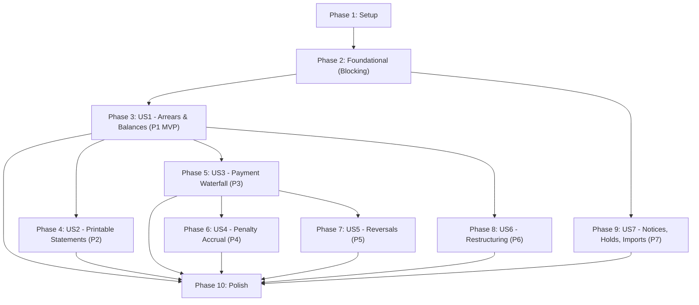

# Tasks: Billing & Ledger Rewrite

**Input**: Design documents from `/specs/002-billing-ledger-rewrite/`
**Prerequisites**: [plan.md](./plan.md), [spec.md](./spec.md), [research.md](./research.md), [data-model.md](./data-model.md), [contracts/](./contracts/), [quickstart.md](./quickstart.md)

**Tests**: In accordance with Constitution Principle VII (Test-First for Domain Logic), tests for ledger journal math, payment waterfalls, schedules, imports, and lot holds are included in each phase.

**Organization**: Tasks are grouped by user story to enable independent implementation and testing of each story.

## Format: `[ID] [P?] [Story] Description`

- **[P]**: Can run in parallel (different files, no dependencies)
- **[Story]**: Which user story this task belongs to (e.g., US1, US2, US3)
- Exact file paths are included in every task description

---

## Phase 1: Setup (Shared Infrastructure)

**Purpose**: Dependency installation and runtime preparation

- [ ] T001 Install `xlsx` dependency for legacy Excel workbook ingestion in `package.json`
- [ ] T002 [P] Verify Vitest configuration and billing test script runner in `package.json`

---

## Phase 2: Foundational (Blocking Prerequisites)

**Purpose**: Database schema migration, core money math, and shared types that MUST be complete before ANY user story can be implemented

**⚠️ CRITICAL**: No user story work can begin until this phase is complete.

- [ ] T003 Create PostgreSQL database migration in `supabase/migrations/20261109000000_billing_ledger_rewrite.sql` defining:
  - `billing_account` with `status IN ('active', 'matured', 'fully_paid', 'fully_paid_unclaimed', 'cancelled', 'restructured', 'forfeited')`, `cadence IN ('monthly', 'quarterly', 'semi-annual', 'annual')`, `amortization_day BETWEEN 1 AND 31`, `total_selling_price NUMERIC(15, 2) CHECK (total_selling_price > 0)`, and partial unique constraint `UNIQUE (property_id) WHERE status IN ('active', 'matured', 'fully_paid', 'fully_paid_unclaimed', 'restructured', 'forfeited') AND reopened_at IS NULL`
  - `billing_schedule` with `term_months INT CHECK (term_months > 0)` and `is_active BOOLEAN DEFAULT true`
  - `billing_schedule_installment` with `amount NUMERIC(15, 2) CHECK (amount > 0)` and `installment_number INT CHECK (installment_number > 0)`
  - `billing_transaction` with `transaction_sequence BIGINT`, `UNIQUE (account_id, transaction_sequence)`, `transaction_type IN ('payment', 'penalty_charge', 'fee_charge', 'adjustment', 'reversal')`, and `amount NUMERIC(15, 2)`
  - `billing_payment` with `payment_mode IN ('Cash', 'Check', 'Bank Transfer', 'Online Deposit')`, `total_received NUMERIC(15, 2) CHECK (total_received > 0)`
  - `billing_payment_application` with `allocation_type IN ('penalty', 'interest', 'tax', 'principal', 'titling_fee', 'storage_fee', 'overpayment_credit')`, foreign key to `installment_id`, and `amount NUMERIC(15, 2) CHECK (amount > 0)`
  - `billing_post_dated_check` with `status IN ('expected', 'holding', 'deposited', 'cleared', 'returned')` and `amount NUMERIC(15, 2) CHECK (amount > 0)`
  - `billing_penalty_policy` with `rate_percent NUMERIC(5, 2) CHECK (rate_percent >= 0)` and `basis IN ('overdue_installment', 'remaining_balance')`
  - `billing_account_penalty_arrangement` with `authority VARCHAR(100)` and `extends_contract_term BOOLEAN DEFAULT false`
  - `billing_holding_charge` with `period_month DATE` and `amount NUMERIC(15, 2) DEFAULT 540.00`
  - `billing_account_notice` with `notice_type IN ('1st Notice', '2nd Notice', 'Final Demand')` and `delivery_status IN ('Pending', 'Dispatched', 'Delivered', 'Return to Sender (RTS)')`
  - `billing_import_discrepancy` with `status IN ('pending', 'resolved', 'dismissed')`
  - Database function / view `get_billing_account_summary` computing dynamic balances from append-only transactions
  - RLS policies and role grants for `billing.read`, `billing.create`, `billing.update`, and `legal.read`
- [ ] T004 [P] Implement centavo precision arithmetic utilities in `lib/billing/money.ts` (`roundCentavos`, `addMoney`, `subtractMoney`, `multiplyMoney`, `divideMoneyWithResidual`) ensuring `Math.round((val + Number.EPSILON) * 100) / 100` and zero floating-point accumulation
- [ ] T005 [P] Implement installment schedule generator in `lib/billing/schedule.ts` enforcing `SUM(installment.amount) === total_selling_price` with residual centavos placed in final installment
- [ ] T006 [P] Update domain TypeScript interfaces in `lib/types/billing.ts` to reflect the rewritten schema, account states, transactions, and statement types
- [ ] T007 [P] Update Zod validation schemas in `lib/validations/billing.ts` matching contracts in `specs/002-billing-ledger-rewrite/contracts/billing-actions.ts`

**Checkpoint**: Foundation ready — database schema, money arithmetic, schedule generators, and types verified.

---

## Phase 3: User Story 1 - Know what every account owes right now (Priority: P1) 🎯 MVP

**Goal**: Billing head opens billing screen and, for any account, sees the outstanding balance, installments behind, and oldest unpaid installment derived dynamically from transactions without stored totals or out-of-order corruption.

**Independent Test**: Load billing account with 60 installments and 14 payments; verify balance matches hand calculation. Post backdated payment 3 years in the past; verify balance, installments behind, and aging update dynamically with zero row overwrites.

### Tests for User Story 1
- [ ] T008 [P] [US1] Create integration test in `scripts/tests/billing/billing-journal.test.ts` verifying dynamic balance derivation, out-of-order backdated payment insertion, and aging metrics calculation

### Implementation for User Story 1
- [ ] T009 [US1] Implement server query action `getBillingAccounts` in `lib/actions/billing.ts` using `createScope(['billing.read'])` with pagination, status filters, and aging calculation
- [ ] T010 [US1] Implement server query action `getBillingAccountDetail` in `lib/actions/billing.ts` returning dynamic summary, active schedule, transactions journal, and lot hold status
- [ ] T011 [US1] Implement server mutation action `createBillingAccount` in `lib/actions/billing.ts` using `createScope(['billing.create'])` enforcing single live contract per lot (`FR-005`) and generating version 1 schedule
- [ ] T012 [P] [US1] Update `components/dashboard-billing/billing-kpi-cards.tsx` to display real-time arrears, maturing accounts, and aging breakdown without stored totals
- [ ] T013 [P] [US1] Update `components/dashboard-billing/billing-account-card.tsx` to display canonical account statuses (`active`, `matured`, `fully_paid`, `fully_paid_unclaimed`, `forfeited`) and lot hold badges
- [ ] T014 [US1] Refactor `components/dashboard-billing/billing-records-section.tsx` and `app/(dashboard)/dashboard/billing/page.tsx` to consume dynamic accounts query and aging filters

**Checkpoint**: User Story 1 functional and independently testable as MVP.

---

## Phase 4: User Story 2 - Issue a statement the buyer can be handed (Priority: P2)

**Goal**: Produce a printable statement for any buyer showing contract terms, every installment, status, penalties charged, and amount due rounded to centavos with zero jargon.

**Independent Test**: Generate a statement for an account with late and on-time payments; verify printable output has <= 2 decimal places on all figures and sums match on-screen balances.

### Tests for User Story 2
- [ ] T015 [P] [US2] Create integration test in `scripts/tests/billing/billing-statement.test.ts` verifying statement generation time (<2s), centavo formatting, and canonical vocabulary ("Matured", "Total Selling Price", "Penalty")

### Implementation for User Story 2
- [ ] T016 [US2] Implement server action `generateStatement` in `lib/actions/billing.ts` using `createScope(['billing.read'])` tracing every figure to dated transaction rows (`FR-041`, `FR-042`)
- [ ] T017 [US2] Create printable statement view in `components/dashboard-billing/billing-statement-view.tsx` with print styles (`@media print`), installment breakdown table, and charge audit trail
- [ ] T018 [US2] Create statement preview page in `app/(dashboard)/dashboard/billing/[accountId]/page.tsx` with PDF export trigger and print button

**Checkpoint**: User Stories 1 AND 2 functional and independently testable.

---

## Phase 5: User Story 3 - Post a payment and see it applied where the contract says (Priority: P3)

**Goal**: Cashier posts payments (cash, check, bank transfer); system allocates money per contract waterfall (penalties -> interest -> taxes -> principal), issues receipt from series, tracks overpayment credits, and treats PDCs as record-only.

**Independent Test**: Post payment larger than 1 installment but smaller than total arrears; verify waterfall allocation order, receipt number series, and balance movement. Post PDC and confirm zero balance movement until cleared.

### Tests for User Story 3
- [ ] T019 [P] [US3] Create integration test in `scripts/tests/billing/billing-waterfall.test.ts` verifying contract waterfall allocation order, overpayment credit balances (`FR-021`), and PDC lifecycle

### Implementation for User Story 3
- [ ] T020 [US3] Implement waterfall allocation engine in `lib/billing/waterfall.ts` applying incoming money to penalties, interest, taxes, then principal with named installments (`FR-016`, `FR-018`) and crediting excess as negative balance (`FR-021`)
- [ ] T021 [US3] Implement server action `recordPayment` in `lib/actions/billing.ts` using `createScope(['billing.create'])` inserting `billing_transaction`, `billing_payment`, and `billing_payment_application` atomically
- [ ] T022 [US3] Implement server action `recordPostDatedCheck` and `updatePdcStatus` in `lib/actions/billing.ts` enforcing record-only behavior without moving balance until cleared (`FR-019`)
- [ ] T023 [P] [US3] Refactor `components/dashboard-billing/billing-payment-modal.tsx` with waterfall allocation preview, receipt series selector, and receipt file attachment
- [ ] T024 [P] [US3] Create `components/dashboard-billing/billing-pdc-modal.tsx` for registering and tracking post-dated checks

**Checkpoint**: User Stories 1, 2, and 3 functional and independently testable.

---

## Phase 6: User Story 4 - Charge penalties under the policy that applied then (Priority: P4)

**Goal**: Billing head runs penalty accrual for a period at the rate and basis that governed that period for that account; idempotent re-runs; storage fees (₱540/mo) tracked outside contract.

**Independent Test**: Charge penalties for a historical period on account whose arrangement changed; confirm historical rate applied; rerun month and verify no duplicate charge.

### Tests for User Story 4
- [ ] T025 [P] [US4] Create integration test in `scripts/tests/billing/billing-penalties.test.ts` verifying effective-dated penalty calculations, idempotency on re-run (`FR-028`, `SC-005`), and storage fee accrual (`FR-033`)

### Implementation for User Story 4
- [ ] T026 [US4] Implement penalty calculation engine in `lib/billing/penalties.ts` resolving account policy by charge period (`FR-026`), freezing applied rate/basis (`FR-027`), and calculating ₱540 storage fees post-title release (`FR-033`)
- [ ] T027 [US4] Implement server action `attachPenaltyArrangement` in `lib/actions/billing.ts` using `createScope(['billing.update'])` with authority and contract extension flags (`FR-030`)
- [ ] T028 [US4] Implement server action `runPenaltyAccrual` in `lib/actions/billing.ts` posting `penalty_charge` transactions idempotently
- [ ] T029 [P] [US4] Create penalty policy attachment modal in `components/dashboard-billing/billing-penalty-modal.tsx` supporting Bayanihan moratoriums and amnesties

**Checkpoint**: User Stories 1 through 4 functional and independently testable.

---

## Phase 7: User Story 5 - Correct a mistake without erasing what happened (Priority: P5)

**Goal**: Billing head reverses a payment or adjustment without deleting posted entries; both original and reversal entries visible in history, and reversals cannot be reversed.

**Independent Test**: Post payment, reverse it with reason; verify balance returns to prior value, history shows both entries, and attempting to reverse the reversal fails.

### Tests for User Story 5
- [ ] T030 [P] [US5] Add reversal test cases to `scripts/tests/billing/billing-journal.test.ts` verifying non-destructive reversals, anti-double-reversal guards (`FR-012`), and balance restoration (`SC-004`)

### Implementation for User Story 5
- [ ] T031 [US5] Implement server action `reverseTransaction` in `lib/actions/billing.ts` using `createScope(['billing.update'])` verifying target has not been reversed, posting signed reversal transaction, and marking `is_reversed = true`
- [ ] T032 [US5] Create transaction reversal dialog in `components/dashboard-billing/billing-reversal-modal.tsx` requiring staff reason and showing preview of restored balance

**Checkpoint**: User Stories 1 through 5 functional and independently testable.

---

## Phase 8: User Story 6 - Restructure a contract and keep the history intact (Priority: P6)

**Goal**: Buyer agrees a compromise and re-spread balance; billing head issues a new schedule version re-spreading unpaid principal (capped at 12 months) while preserving prior schedule history and settling penalties separately.

**Independent Test**: Restructure account midway through term; confirm prior installments unchanged, future installments follow new terms, and original terms remain retrievable.

### Tests for User Story 6
- [ ] T033 [P] [US6] Create integration test in `scripts/tests/billing/billing-restructure.test.ts` verifying schedule versioning, principal-only re-spreading (`FR-040`), and side-by-side terms comparison

### Implementation for User Story 6
- [ ] T034 [US6] Implement server action `restructureAccount` in `lib/actions/billing.ts` using `createScope(['billing.update'])` creating `billing_schedule` version $N+1$ for unpaid principal while leaving accrued penalties to compromise agreements (`FR-040`)
- [ ] T035 [US6] Implement server action `recordCompromise` in `lib/actions/billing.ts` saving agreed penalty reduction with original penalty visible for comparison (`FR-034`)
- [ ] T036 [P] [US6] Create `components/dashboard-billing/billing-restructure-modal.tsx` allowing term selection (max 12 mos) and displaying side-by-side original vs compromised terms
- [ ] T037 [P] [US6] Refactor `components/dashboard-billing/billing-compromise-modal.tsx` to record agreed penalty amounts with approval tracking

**Checkpoint**: User Stories 1 through 6 functional and independently testable.

---

## Phase 9: User Story 7 - Demand notices, lot holds, legacy Excel import & discrepancy review queue (Priority: P7)

**Goal**: Preserve demand notice paper trail with RTS tracking; import legacy Excel (.xlsx/.xls) workbooks into discrepancy review queue; enforce lot holds on forfeiture with Maceda cash surrender value display; deliberate lot reopening.

**Independent Test**: Import Excel workbook with conflicting totals and verify discrepancy queue logging; trigger forfeiture and confirm lot hold prevents resale; reopen lot with complete document checklist.

### Tests for User Story 7
- [ ] T038 [P] [US7] Create integration test in `scripts/tests/billing/billing-excel-import.test.ts` verifying SheetJS parsing of legacy workbooks, recomputation of balances from rows, and discrepancy queue insertion (`SC-012`, `SC-016`)
- [ ] T039 [P] [US7] Create integration test in `scripts/tests/billing/billing-lot-hold.test.ts` verifying lot hold locking (`FR-060`), Maceda cash surrender value computation (`FR-064`), and deliberate reopening (`FR-062`, `FR-063`)

### Implementation for User Story 7
- [ ] T040 [US7] Implement legacy Excel workbook parser in `lib/billing/excel-importer.ts` using `xlsx` (SheetJS) extracting dated rows, recomputing balances, and identifying arithmetic discrepancies (`FR-056`, `FR-057`)
- [ ] T041 [US7] Implement Maceda cash surrender value calculation in `lib/billing/maceda.ts` (`FR-064`) computing statutory return percentage based on installment years
- [ ] T042 [US7] Implement server actions `importLegacyStatements` and `resolveDiscrepancy` in `lib/actions/billing.ts` using `createScope(['billing.create'])` and `createScope(['billing.update'])`
- [ ] T043 [US7] Implement server action `reopenForfeitedLot` in `lib/actions/billing.ts` recording `reopened_by` and releasing property lot while keeping forfeited account closed (`FR-062`, `FR-063`)
- [ ] T044 [US7] Refactor demand notice actions (`recordNotice`, `updateNoticeDelivery`) in `lib/actions/billing.ts` supporting courier tracking and RTS re-dispatch attempts (`FR-048`, `FR-049`)
- [ ] T045 [P] [US7] Create `components/dashboard-billing/billing-excel-import-modal.tsx` supporting drag-and-drop `.xlsx`, `.xls`, and `.csv` files with progress feedback
- [ ] T046 [P] [US7] Create `components/dashboard-billing/billing-discrepancy-modal.tsx` displaying discrepancy details, row comparisons, and resolution notes form
- [ ] T047 [P] [US7] Update `components/dashboard-billing/billing-notice-modal.tsx` with RTS re-dispatch history and proof attachments
- [ ] T048 [P] [US7] Create lot hold banner and release modal in `components/dashboard-billing/billing-lot-hold-dialog.tsx` requiring document checklist sign-off

**Checkpoint**: All 7 User Stories fully functional and independently testable.

---

## Phase 10: Polish & Cross-Cutting Concerns

**Purpose**: System integration, validation runs, and codebase cleanup

- [ ] T049 [P] Execute end-to-end test scenarios documented in `specs/002-billing-ledger-rewrite/quickstart.md`
- [ ] T050 Run full billing E2E Vitest suite: `npm run test:e2e:billing`
- [ ] T051 Verify layout fit and mobile-view responsiveness per `.agents/skills/layout-verification/SKILL.md`
- [ ] T052 Remove deprecated trigger functions and obsolete legacy billing files

---

## Dependencies & Execution Order

### Phase Dependencies

### User Story Dependencies

- **US1 (P1)**: Starts immediately after Phase 2 (Foundational). Delivers the core balance and aging views (MVP).
- **US2 (P2)**: Depends on US1 data structures to generate printable statements.
- **US3 (P3)**: Depends on US1 account setup; provides payment posting and waterfall allocations.
- **US4 (P4)**: Depends on US1 schedules and US3 payment journal.
- **US5 (P5)**: Depends on US3 payments journal to execute reversals.
- **US6 (P6)**: Depends on US1 schedule models and US4 penalty compromise logic.
- **US7 (P7)**: Can proceed in parallel with US3–US6 once Phase 2 is complete.

---

## Parallel Opportunities

- **Phase 1**: T001 and T002 can run in parallel.
- **Phase 2**: T004 (`money.ts`), T005 (`schedule.ts`), T006 (`types`), and T007 (`validations`) can all run in parallel after T003 migration is defined.
- **Within US1**: T008 (test), T012 (`kpi-cards`), and T013 (`account-card`) can run in parallel.
- **Within US3**: T019 (test), T023 (`payment-modal`), and T024 (`pdc-modal`) can run in parallel.
- **Within US4**: T025 (test) and T029 (`penalty-modal`) can run in parallel.
- **Within US6**: T033 (test), T036 (`restructure-modal`), and T037 (`compromise-modal`) can run in parallel.
- **Within US7**: T038 (test), T039 (test), T045 (`excel-import-modal`), T046 (`discrepancy-modal`), T047 (`notice-modal`), and T048 (`lot-hold-dialog`) can all run in parallel.

---

## Implementation Strategy

### MVP First (User Story 1 Only)
1. Complete **Phase 1: Setup** (install `xlsx`).
2. Complete **Phase 2: Foundational** (migration, money arithmetic, schedule logic).
3. Complete **Phase 3: User Story 1** (dynamic balance lookup and aging).
4. **VALIDATE MVP**: Run `scripts/tests/billing/billing-journal.test.ts` to prove that balances and aging are derived dynamically with zero stored totals.

### Incremental Delivery
- Add **US2** (Statements) -> Hand buyers clear, centavo-accurate statements.
- Add **US3** (Payments & Waterfall) -> Cashier collection workflows.
- Add **US4** (Penalties) & **US5** (Reversals) -> Effective-dated policy & non-destructive audit trail.
- Add **US6** (Restructuring) -> Compromise agreements and re-spread schedules.
- Add **US7** (Notices, Holds & Excel Import) -> Historical recovery and legal paper trail.
