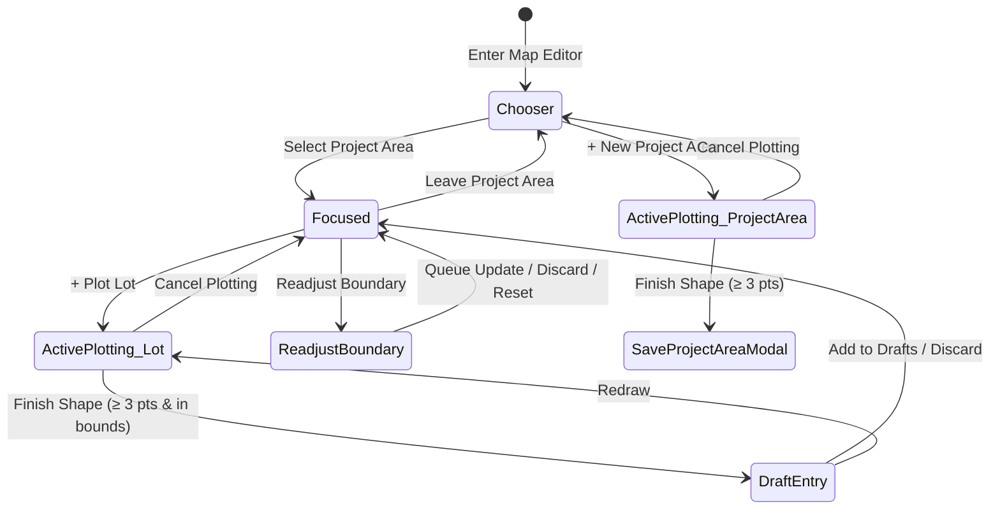

# Data Model & State Transitions: Map Editor Card

## Entities & State Model

The Map Editor Card is a client-side stateful UI controller for subdivision and lot plotting operations. It does not introduce new database tables, but strictly coordinates existing project area, plot, and draft states.

## State Definitions

| State | Trigger / Condition | Visual Footprint | Primary Controls |
|---|---|---|---|
| **Chooser** | `!activeProjectArea && plotType === null` | Stable `w-[340px]`, `p-3` | Active/Archived Tabs, Project Area List, "+ New Project Area", "Leave Editor" |
| **Focused** | `activeProjectArea && plotType === null && !activeDraft && !readjustProjectArea` | Stable `w-[340px]`, `p-3` | Project Area Name, Archive Status, "+ Plot Lot", "Readjust Boundary", "Leave Project Area" |
| **Active Plotting** | `plotType !== null` (`'lot'` or `'project-area'`) | Stable `w-[340px]`, `p-3` | Status Badge (pt count, outside boundary pill), Undo, Cancel, Finish Shape |
| **Draft Entry** | `activeDraft !== null && !readjustProjectArea` | Stable `w-[340px]`, `p-3` | Block No. & Lot No. inputs, Area display, Redraw, Discard, Add to Drafts |
| **Readjust Boundary** | `readjustProjectArea !== null` | Compact `w-[360px]`, `p-3.5` | Corner count, Area display, Drag instructions, Reset, Discard, Queue Update |

## Layout Invariants & Constraints

1. **Card Container Width**:
   - Uniform `w-[340px]` applied to the main floating card container.
   - `max-w-[calc(100vw-2rem)]` safeguard ensures compatibility on small viewport widths.
2. **Button Heights**:
   - Primary actions (`+ Plot Lot`, `Finish Shape`, `Add to Drafts`, `Queue Update`): `h-8` (`32px`).
   - Secondary / compact actions (`Leave Editor`, `Undo`, `Cancel`, `Redraw`, `Discard`): `h-7` (`28px`).
3. **List Scroll Stability**:
   - `max-h-[280px]` with `scrollbar-gutter: stable` or reserved padding so that appearance of scrollbar does not cause horizontal reflow.
4. **Header Stability**:
   - Fixed minimum heights for card header rows so badges and status alerts do not cause vertical jitter or wrap onto action buttons.
