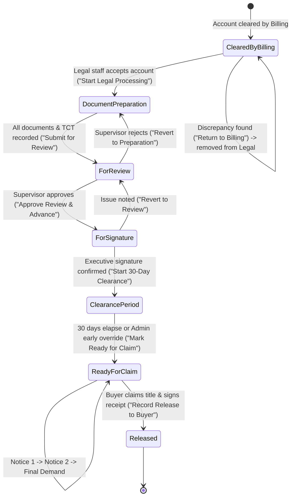

# Phase 1 Data Model: Title Dialog Stage Pages Redesign

**Feature**: `004-title-dialog-pages-redesign`
**Date**: 2026-11-08

## Entities and View Models

This document defines the entities, component prop contracts, and lifecycle state models consumed and mutated across each of the 5 redesigned title dialog stage pages.

---

### 1. Title Lifecycle & Stage Model

---

### 2. View Entities & Streamlined View Models

#### 2.1 Account Intake View Model (`TitleIntakeTab`)

Represents the data consumed when viewing an account cleared by billing:

| Attribute | Type | Source | Description |
|---|---|---|---|
| `item` | `TitleDialogItem` | `useLandTitles()` | Active item (`awaiting` or `title`) |
| `clientName` | `string` | Derived | Full name of principal buyer |
| `coBuyers` | `string[]` | Derived | Co-buyers associated with account |
| `propertyRef` | `string` | `lotRefLabel()` | Block and Lot label (e.g., "Block 4 Lot 12") |
| `projectArea` | `string` | `property.project_area.name` | Named project area |
| `areaSize` | `number \| null` | `property.area_size` | Lot area in square meters |
| `pricePerSqm` | `number \| null` | `property.price_per_sqm` | Contract price per sqm |
| `titleNumber` | `string \| null` | `property.title_number` | Transfer Certificate of Title or Mother Title number |
| `clearedAt` | `string \| null` | `awaiting.cleared_at` | Timestamp when billing clearance was granted |
| `primaryContact` | `ContactInfo \| null` | `client.contact_info` | Primary phone or email channel |
| `address` | `string \| null` | `client.address` | Street/Barangay/City address |

#### 2.2 Document Preparation & Review Workbench View Model (`TitlePacketTab`)

Represents the streamlined document packet and verification state:

| Attribute | Type | Source | Description |
|---|---|---|---|
| `title` | `LandTitle` | Props | Full LandTitle domain object |
| `documents` | `ClientDocument[]` | Props | List of uploaded release documents |
| `prepState` | `DocPrepState` | `getDocPrepState()` | Completion flags (`step1Done`, `requiredCount`, `missingCount`, `hasRecordedTct`) |
| `isExecutiveSigned` | `boolean` | Local State | Executive signature verification toggle |
| `titleNumberInput` | `string` | Local State | Editable TCT number string |
| `isEditingTct` | `boolean` | Local State | Toggle for inline TCT editing form directly in header toolbar |
| `revertTarget` | `'Document Preparation' \| 'For Review' \| null` | Local State | Target stage when executing a stage reversion |
| `revertReason` | `string` | Local State | Explanation required when reverting a stage |

*Note: The duplicate `StepChecklist` (`prepSteps`) has been removed from this view model; overall workflow progression is tracked exclusively by the left navigation rail.*

#### 2.3 30-Day Clearance Inspection View Model (`TitleClearanceTab`)

Represents the streamlined countdown meter and gating controls:

| Attribute | Type | Source | Description |
|---|---|---|---|
| `title` | `LandTitle` | Props | Active LandTitle record |
| `clearanceStartedAt` | `string \| null` | `title.clearance_started_at` | Window start timestamp |
| `clearance` | `ClearanceProgress` | `getClearanceProgress()` | Computed status (`daysRemaining`, `percentElapsed`, `isComplete`, `targetDate`) |
| `canEdit` | `boolean` | `useLandTitles()` | Whether the user has `legal.update` permission |
| `isAdmin` | `boolean` | `useLandTitles()` | Whether the user has system_admin or admin override role |

#### 2.4 Client Outreach & Notices View Model (`TitleNoticesTab`)

Represents the elevated milestone action, condensed storage fees, and notice audit log:

| Attribute | Type | Source | Description |
|---|---|---|---|
| `title` | `LandTitle` | Props | Active LandTitle record |
| `notices` | `LandTitleNotice[]` | Props | Array of notice records for this title |
| `storageFee` | `StorageFeeAssessment \| null` | `calculateStorageFee(title)` | Computed storage fee breakdown (grace end, overdue months, accrued fee) |
| `sortedNotices` | `LandTitleNotice[]` | Derived | Chronologically ordered notice array |
| `ongoingNotice` | `LandTitleNotice \| null` | Derived | Active, unresolved notice (status: 'ongoing') |
| `nextNoticeNumber` | `1 \| 2 \| 3` | Derived | Sequential notice number to dispatch next |
| `noticeStatusChoice` | `'received' \| 'returned_to_sender'` | Local State | Delivery outcome choice |
| `statusFileInput` | `File \| null` | Local State | Uploaded waybill or RTS proof scan |
| `statusNotesInput` | `string` | Local State | Waybill number or RTS reason notes |

#### 2.5 Turnover Dossier Archive View Model (`TitleReleasedTab`)

Represents the compact certificate-grade permanent turnover archive:

| Attribute | Type | Source | Description |
|---|---|---|---|
| `title` | `LandTitle` | Props | Released LandTitle record |
| `releasedDate` | `Date \| null` | `getReleasedDate(title)` | Timestamp when physical handover occurred |
| `recipientName` | `string` | Derived | Recipient full name (`released_to_name` or buyer name) |
| `recipientId` | `string` | `title.released_to_id` | Government-issued ID number presented |
| `isPrincipalBuyer` | `boolean` | Derived | True if recipient matches buyer name |
| `releaseRemarks` | `string \| null` | `title.release_remarks` | Archival notes and receipt reference |
| `releaseAttachment` | `FileAttachment \| null` | `title.release_attachment` | Scanned signed turnover clearance sheet |
| `storageFee` | `StorageFeeAssessment \| null` | `calculateStorageFee(title)` | Record of vault storage fee at time of turnover |

---

### 3. Validation Rules

- **Intake**: Accept (`createTitle`) requires an active property with billing clearance; returning to billing (`revertClearance`) requires an explicit confirmation modal.
- **TCT Recording**: TCT number cannot be an empty or whitespace-only string; must follow standard format (e.g., `T-123456`).
- **Submit for Review Gate**: Requires `prepState.step1Done === true` (all required release documents uploaded, TCT number present).
- **Executive Signature Gate**: Requires `isExecutiveSigned === true` to transition from `For Signature` to `Clearance Period`.
- **Clearance Period Gate**: Standard staff cannot advance to `Ready for Claim` if `clearance.isComplete === false`. Admin override requires confirmation.
- **Notice Resolution**: Resolving an ongoing notice requires a proof attachment (`statusFileInput !== null`) and delivery outcome selection.
- **Buyer Turnover**: Recording release requires recipient full name, valid ID number, and signed clearance sheet scan.
