# Phase 1 Data Model & UI State Architecture

**Feature**: `005-billing-ui-rewrite`  
**Date**: 2026-11-08  
**Status**: Completed  

## 1. UI View Models & State Schemas

### 1.1 Dashboard Top-Level Navigation State

```typescript
export type BillingTopTab = 'accounts' | 'pdcs' | 'discrepancies';

export interface BillingFilterState {
  search: string;
  status: 'all' | 'active' | 'in_arrears' | 'matured' | 'cleared' | 'forfeited';
  viewMode: 'table' | 'cards';
  sortField: 'buyer' | 'lot' | 'balance' | 'arrears' | 'aging';
  sortDirection: 'asc' | 'desc';
  page: number;
  pageSize: number;
}
```

### 1.2 Modal State Discriminated Union

Centralized modal state ensures that only one primary cashier or audit modal is open at a time, eliminating modal collision or backdrop stacking bugs:

```typescript
export type ActiveBillingModal =
  | { type: 'idle' }
  | { type: 'payment'; account: BillingAccountSummary }
  | { type: 'reversal'; account: BillingAccountSummary; transaction: BillingTransaction }
  | { type: 'restructure'; account: BillingAccountSummary }
  | { type: 'record-pdc'; account: BillingAccountSummary }
  | { type: 'penalty-policy'; account: BillingAccountSummary }
  | { type: 'excel-import' }
  | { type: 'resolve-discrepancy'; discrepancy: BillingImportDiscrepancy }
  | { type: 'lot-hold-release'; account: BillingAccountSummary };
```

### 1.3 Account Workspace Tab State

```typescript
export type BillingWorkspaceTab =
  | 'ledger'
  | 'schedule'
  | 'pdcs'
  | 'penalties'
  | 'notices'
  | 'statement';

export interface BillingAccountWorkspaceProps {
  account: BillingAccountSummary;
  initialTab?: BillingWorkspaceTab;
  onRefresh?: () => Promise<void>;
  canEdit?: boolean;
}
```

### 1.4 Global PDC Portfolio View Model

```typescript
export interface PdcPortfolioItem {
  check_id: string;
  account_id: string;
  buyer_name: string;
  lot_designation: string;
  bank_name: string;
  check_number: string;
  check_date: string;
  amount: number;
  status: 'received' | 'deposited' | 'cleared' | 'bounced' | 'replaced';
  days_until_maturity: number;
  notes?: string | null;
}
```

### 1.5 Legacy Import Discrepancy View Model

```typescript
export interface DiscrepancyQueueItem {
  discrepancy_id: string;
  account_id: string;
  buyer_name: string;
  lot_designation: string;
  discrepancy_type: 'total_mismatch' | 'unbalanced_application' | 'date_anomaly' | 'formula_drift';
  raw_file_value: number | string;
  computed_system_value: number | string;
  variance_amount?: number;
  status: 'pending' | 'resolved' | 'ignored';
  resolved_at?: string | null;
  resolved_by?: string | null;
  resolution_notes?: string | null;
}
```

---

## 2. Server Action Bindings & Data Flow

```mermaid
flowchart TD
    Dashboard["Billing Dashboard (/dashboard/billing)"]
    Workspace["Account Workspace (/dashboard/billing/[accountId])"]

    subgraph DataFetching["Data Fetching Layer"]
        getBillingAccounts["getBillingAccounts()"]
        getBillingAccountDetail["getBillingAccountDetail(accountId)"]
        getDiscrepancies["getImportDiscrepancies()"]
        getPdcs["getPostDatedChecks()"]
    end

    subgraph Mutations["Mutations Layer (createScope)"]
        recordPayment["recordPayment()"]
        reverseTransaction["reverseTransaction()"]
        restructureAccount["restructureAccount()"]
        updatePdcStatus["updatePdcStatus()"]
        resolveDiscrepancy["resolveDiscrepancy()"]
        reopenForfeitedLot["reopenForfeitedLot()"]
        generateStatement["generateStatement()"]
    end

    Dashboard --> getBillingAccounts
    Dashboard --> getDiscrepancies
    Dashboard --> getPdcs
    Workspace --> getBillingAccountDetail
    Workspace --> generateStatement

    Dashboard -.-> recordPayment
    Dashboard -.-> resolveDiscrepancy
    Dashboard -.-> updatePdcStatus

    Workspace -.-> recordPayment
    Workspace -.-> reverseTransaction
    Workspace -.-> restructureAccount
    Workspace -.-> reopenForfeitedLot
```



---

## 3. UI Invariants & Guardrails

1. **Rule of 2 & Design Tokens**: No custom inline hex colors or hardcoded box shadows. Use standard semantic classes (`bg-card`, `border-border`, `text-foreground`, `bg-muted`).
2. **Canonical Badges**:
   - `Active` $\rightarrow$ `variant="secondary"` (Neutral/Slate)
   - `In Arrears` $\rightarrow$ `variant="warning"` (Amber tint)
   - `Matured` $\rightarrow$ `variant="default"` (Blue tint)
   - `Cleared` $\rightarrow$ `variant="success"` (Green tint)
   - `Forfeited` $\rightarrow$ `variant="destructive"` (Rose/Red tint)
3. **No Horizontal Clipping**: Tables must implement `overflow-x-auto` with min-width wrappers and sticky action headers.
4. **Number Formatting**: Every monetary number in tables and dialogs MUST pass through centavo formatting with exact Philippine Peso currency symbols (`₱1,234.56`).
