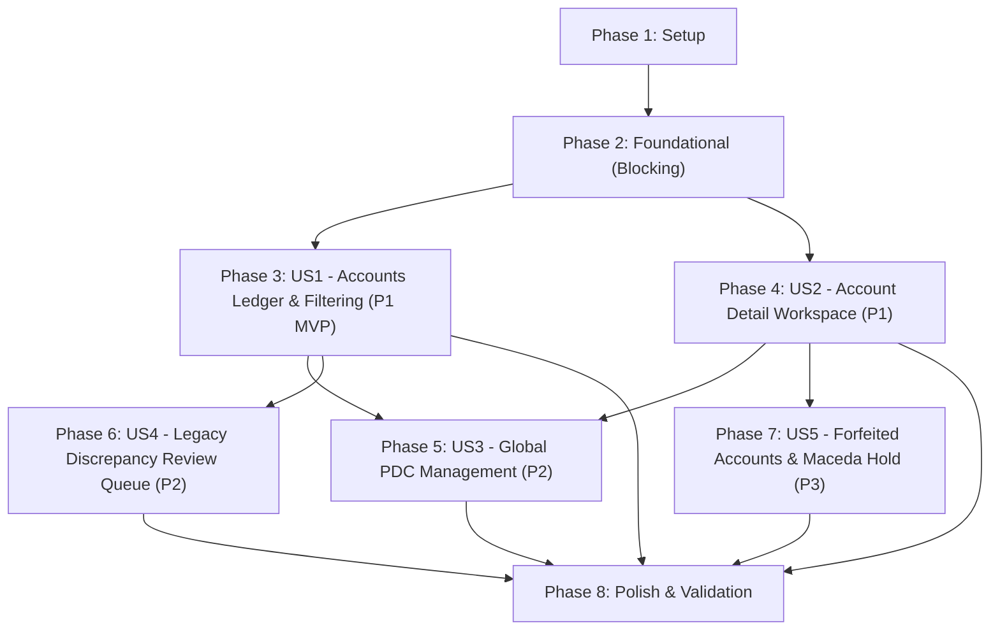

# Tasks: Billing UI Rewrite & User Experience Overhaul

**Input**: Design documents from `/specs/005-billing-ui-rewrite/`  
**Prerequisites**: `plan.md`, `spec.md`, `research.md`, `data-model.md`, `contracts/billing-ui-contracts.ts`  
**Organization**: Tasks are grouped by user story to enable independent implementation and testing of each story.

## Format: `[ID] [P?] [Story] Description`

- **[P]**: Can run in parallel (different files, no dependencies)
- **[Story]**: Which user story this task belongs to (e.g., US1, US2, US3)
- Include exact file paths in descriptions

---

## Phase 1: Setup (Shared Infrastructure)

**Purpose**: Project initialization, contract alignment, and test scaffolding

- [x] T001 [P] Ensure contract interfaces in `specs/005-billing-ui-rewrite/contracts/billing-ui-contracts.ts` match `lib/types/billing.ts`
- [x] T002 [P] Create initial UI test harness in `scripts/tests/billing/billing-ui-layout.test.ts`

---

## Phase 2: Foundational (Blocking Prerequisites)

**Purpose**: Core state management and shared formatters that all user stories depend on

**⚠️ CRITICAL**: No user story work can begin until this phase is complete

- [x] T003 [P] Extend `lib/hooks/use-billing-accounts.tsx` with top-level tab state (`accounts`, `pdcs`, `discrepancies`), filter state, and modal state management
- [x] T004 [P] Add canonical currency formatters and badge variant helpers in `lib/status-colors.ts` enforcing zero "delinquent" terminology

**Checkpoint**: Foundation ready — user story implementation can now begin

---

## Phase 3: User Story 1 - Dense Operational Accounts Ledger & Filtering (Priority: P1) 🎯 MVP

**Goal**: Deliver a high-density, searchable, sortable table for accounts with multi-parameter filter pills and quick cashier actions.

**Independent Test**: Load `/dashboard/billing`, verify accounts render in a dense table, filter by "In Arrears", search by buyer name/lot in $<200\text{ms}$, and open payment modal in 1 click.

- [x] T005 [P] [US1] Create high-density table toolbar in `components/dashboard-billing/billing-table-toolbar.tsx` with search, status pills (Active, In Arrears, Matured, Cleared, Forfeited), and table/card view toggle
- [x] T006 [P] [US1] Implement dense accounts table in `components/dashboard-billing/billing-accounts-table.tsx` with sticky header, balance formatting, aging indicators, and inline action triggers
- [x] T007 [US1] Update `components/dashboard-billing/billing-kpi-cards.tsx` to display active portfolio metrics (Total Receivables, Collected MTD, In Arrears, Maturing PDCs, Pending Discrepancies)
- [x] T008 [US1] Wire `components/dashboard-billing/billing-records-section.tsx` to host top tabs (`Accounts`, `PDC Tracker`, `Review Queue`), toolbar, table, and mobile card toggle

**Checkpoint**: User Story 1 (MVP) is fully functional and independently testable on `/dashboard/billing`.

---

## Phase 4: User Story 2 - Comprehensive Account Detail & Master-Detail Journal Workspace (Priority: P1)

**Goal**: Deliver a dedicated two-column master-detail workspace route (`/dashboard/billing/[accountId]`) with persistent left summary card and tabbed right tables, defaulting to the Transaction Journal.

**Independent Test**: Navigate to `/dashboard/billing/[accountId]`, verify left panel displays contract metadata and dynamic balance KPIs, verify right panel defaults to the Transaction Journal with sequential numbers (`#1`, `#2`), and execute an inline non-destructive payment reversal.

- [x] T009 [P] [US2] Implement append-only journal tab in `components/dashboard-billing/billing-journal-tab.tsx` displaying monotonic sequences, value dates, OR receipts, and inline reversal triggers
- [x] T010 [P] [US2] Implement versioned installment schedule tab in `components/dashboard-billing/billing-schedule-tab.tsx` showing active/archived schedule lines and due dates
- [x] T011 [P] [US2] Implement account-specific PDC tab in `components/dashboard-billing/billing-pdc-tab.tsx` displaying on-hand checks and deposit statuses
- [x] T012 [P] [US2] Implement penalties and waiver tab in `components/dashboard-billing/billing-penalties-tab.tsx` displaying attached policies and monthly calculation inspector
- [x] T013 [P] [US2] Implement legal notices and deliberate lot hold tab in `components/dashboard-billing/billing-notices-tab.tsx` displaying demand letter history and Maceda surrender value
- [x] T014 [US2] Implement two-column master-detail container in `components/dashboard-billing/billing-account-detail-workspace.tsx` with sticky left summary card, quick action buttons, and responsive vertical stacking on viewports < 1024px
- [x] T015 [US2] Update dedicated page route in `app/(dashboard)/dashboard/billing/[accountId]/page.tsx` to load and render the new master-detail workspace

**Checkpoint**: User Stories 1 AND 2 are complete; staff can manage the portfolio table and drill down into authoritative individual account ledgers.

---

## Phase 5: User Story 3 - Post-Dated Check (PDC) Management & Maturing Alerts (Priority: P2)

**Goal**: Deliver a global PDC portfolio management tracker across all accounts with maturing check alerts and status transitions.

**Independent Test**: Click "PDC Tracker" tab on `/dashboard/billing`, filter checks maturing in the next 30 days, and transition a check from "Received" to "Cleared" or "Bounced".

- [x] T016 [P] [US3] Create global PDC portfolio table in `components/dashboard-billing/billing-pdc-tracker.tsx` with maturity filters, bank tags, and status transition menus
- [x] T017 [US3] Integrate `billing-pdc-tracker.tsx` into the second tab of `components/dashboard-billing/billing-records-section.tsx`
- [x] T018 [US3] Connect PDC status mutations (`updatePdcStatus`) and check registration modal (`billing-pdc-modal.tsx`) with optimistic table updates

**Checkpoint**: User Story 3 complete; cashiers can monitor and clear maturing checks portfolio-wide.

---

## Phase 6: User Story 4 - Legacy Excel Workbook Import & Discrepancy Review Queue (Priority: P2)

**Goal**: Deliver a dedicated Discrepancy Review Queue on the main billing dashboard for legacy SheetJS workbook discrepancies.

**Independent Test**: Click "Review Queue" tab on `/dashboard/billing`, review an imported discrepancy comparing raw file value vs. recomputed balance, and resolve it with staff justification notes.

- [x] T019 [P] [US4] Create global discrepancy review queue table in `components/dashboard-billing/billing-discrepancy-queue.tsx` showing variance comparisons and audit resolution triggers
- [x] T020 [US4] Integrate `billing-discrepancy-queue.tsx` into the third tab of `components/dashboard-billing/billing-records-section.tsx`
- [x] T021 [US4] Connect `billing-discrepancy-modal.tsx` with `resolveDiscrepancy` server action to clear resolved items with staff timestamp

**Checkpoint**: User Story 4 complete; legacy Excel imports are reconciled with full audit justification.

---

## Phase 7: User Story 5 - Forfeited Accounts, Maceda Statutory Surrender & Deliberate Lot Hold (Priority: P3)

**Goal**: Integrate statutory Maceda Law Cash Surrender Value calculations, grace period tracking, and deliberate lot hold release checklists.

**Independent Test**: Open a forfeited account, verify statutory cash surrender value calculation renders in the legal tab, open the lot hold release dialog, and confirm the lot becomes available only after checklist validation.

- [x] T022 [P] [US5] Update `components/dashboard-billing/billing-lot-hold-dialog.tsx` with RA 6552 statutory cash surrender breakdown, notice verification checklist, and deliberate release sign-off
- [x] T023 [US5] Connect lot hold release action (`reopenForfeitedLot`) to the Account Workspace action bar and property inventory status tags

**Checkpoint**: All 5 User Stories fully implemented.

---

## Phase 8: Polish & Cross-Cutting Concerns

**Purpose**: System-wide layout verification, responsive audits, zero-delinquent terminology scan, and quickstart scenario validation

- [x] T024 [P] Run zero-jargon terminology scan to guarantee 0 occurrences of "delinquent" across all billing components and views
- [x] T025 [P] Run layout and fit verification per `.agents/skills/layout-verification/SKILL.md` (check horizontal overflow, sticky headers, 1366x768 screens, mobile stacks)
- [x] T026 Execute end-to-end interactive validation scenarios documented in `specs/005-billing-ui-rewrite/quickstart.md`
- [x] T027 Run full test suite: `npm run test:e2e:billing` and `npx tsc --noEmit`

---

## Dependencies & Execution Order

### Phase Dependencies

### User Story Dependencies

- **US1 (P1)**: Starts immediately after Foundational Phase 2. Delivers the primary dense table and KPI dashboard.
- **US2 (P1)**: Starts immediately after Foundational Phase 2. Delivers the dedicated two-column master-detail workspace route.
- **US3 (P2)**: Depends on US1 dashboard top tabs to host the PDC tracker.
- **US4 (P2)**: Depends on US1 dashboard top tabs to host the Review Queue.
- **US5 (P3)**: Depends on US2 workspace legal tab to present forfeiture and Maceda surrender controls.

---

## Parallel Opportunities

- **Phase 1**: T001 and T002 can run in parallel.
- **Phase 2**: T003 (`use-billing-accounts.tsx`) and T004 (`status-colors.ts`) can run in parallel.
- **Within US1**: T005 (`toolbar`), T006 (`table`), and T007 (`kpi-cards`) can run in parallel.
- **Within US2**: T009 (`journal-tab`), T010 (`schedule-tab`), T011 (`pdc-tab`), T012 (`penalties-tab`), and T013 (`notices-tab`) can all run in parallel.
- **Within US3 & US4**: T016 (`pdc-tracker`) and T019 (`discrepancy-queue`) can run in parallel.
- **Phase 8**: T024 (`jargon scan`) and T025 (`layout verification`) can run in parallel.

---

## Implementation Strategy

### MVP First (User Story 1 Only)
1. Complete Phase 1 (Setup) and Phase 2 (Foundational).
2. Complete Phase 3 (User Story 1: Dense Accounts Ledger & Filtering).
3. **VALIDATE MVP**: Open `/dashboard/billing`, verify fast search, multi-parameter status pills, and dense layout.

### Incremental Delivery
- Add **US2** (Master-Detail Account Workspace) $\rightarrow$ Full auditability and inline reversals.
- Add **US3** (Global PDC Portfolio) $\rightarrow$ Maturing check deposit reminders.
- Add **US4** (Review Queue) $\rightarrow$ Legacy Excel reconciliation.
- Add **US5** (Maceda Hold) $\rightarrow$ Statutory compliance and deliberate resale safeguards.
