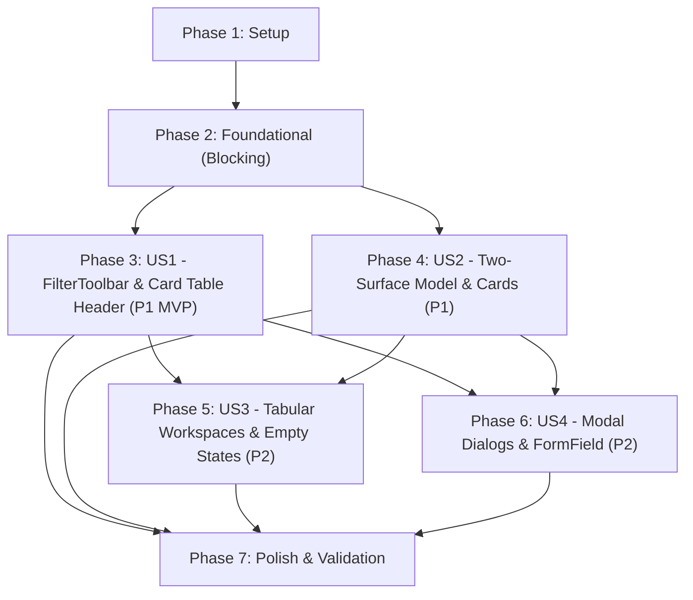

# Tasks: Billing UI Convention & Primitives Alignment

**Input**: Design documents from `/specs/006-billing-ui-alignment/`  
**Prerequisites**: [plan.md](plan.md), [spec.md](spec.md), [research.md](research.md), [data-model.md](data-model.md), [contracts/billing-ui-alignment.contract.ts](contracts/billing-ui-alignment.contract.ts), [quickstart.md](quickstart.md)  
**Organization**: Tasks are grouped by user story to enable independent implementation, visual verification, and incremental delivery.

## Format: `[ID] [P?] [Story] Description`

- **[P]**: Can run in parallel (different files, no conflicting dependencies)
- **[Story]**: Which user story this task belongs to (`[US1]`, `[US2]`, `[US3]`, `[US4]`)
- Include exact file paths in descriptions

---

## Phase 1: Setup (Shared Infrastructure)

**Purpose**: Test scaffolding and baseline convention verification

- [x] T001 Inspect component interfaces and ensure contracts in `specs/006-billing-ui-alignment/contracts/` align with existing primitives in `components/ui/`
- [x] T002 [P] Create initial UI conventions test in `scripts/tests/billing/billing-ui-conventions.test.ts` asserting usage of `Card`, `FilterToolbar`, `EmptyState`, and zero occurrences of "delinquent"

---

## Phase 2: Foundational (Blocking Prerequisites)

**Purpose**: Shared token mappings and controller configurations that all user stories depend on

**⚠️ CRITICAL**: No user story work can begin until this phase is complete

- [x] T003 [P] Update `lib/status-colors.ts` with `BILLING_STATUS_BADGE_VARIANT` ensuring all canonical billing statuses map directly to valid Badge variants (`success`, `warning`, `info`, `destructive`, `secondary`, `outline`)
- [x] T004 [P] Configure list controller options in `lib/hooks/use-billing-accounts.tsx` to provide `useListController` integration with status tabs and search filtering

**Checkpoint**: Foundation ready — user story implementation can now begin

---

## Phase 3: User Story 1 - Declarative FilterToolbar & Card Table Header Integration (Priority: P1) 🎯 MVP

**Goal**: Deliver a unified tabular view on `/dashboard/billing` using `<Card>`, `<CardStickyHeader>`, `<FilterToolbar>`, and `<ListPaginationFooter>` matching `/dashboard/clients`.

**Independent Test**: Load `/dashboard/billing`, verify the accounts table is wrapped inside a standard `<Card>` with `<CardStickyHeader>` and `<FilterToolbar>`, filter by "In Arrears", search with instant clearing (`X`), and inspect `<ListPaginationFooter>` at the bottom.

- [x] T005 [US1] Refactor `components/dashboard-billing/billing-records-section.tsx` to mount Top Tabs and connect `useListController` with `<CardStickyHeader>` and `<FilterToolbar>`
- [x] T006 [US1] Refactor `components/dashboard-billing/billing-accounts-table.tsx` to compose inside `<Card>` with sticky header, standard column widths, `<EmptyState>`, and `<ListPaginationFooter>`
- [x] T007 [P] [US1] Remove deprecated bespoke toolbar `components/dashboard-billing/billing-table-toolbar.tsx` and migrate all consumers to `<FilterToolbar>`
- [x] T008 [P] [US1] Refactor `components/dashboard-billing/billing-pdc-tracker.tsx` to compose within `<Card>` and `<CardStickyHeader>` with `<FilterToolbar>` for check search and maturity filters
- [x] T009 [P] [US1] Refactor `components/dashboard-billing/billing-discrepancy-queue.tsx` to compose within `<Card>` and `<CardStickyHeader>` with `<FilterToolbar>` for discrepancy search and status filtering

**Checkpoint**: User Story 1 (MVP) is fully functional and independently testable on `/dashboard/billing`.

---

## Phase 4: User Story 2 - Uniform Card & Surface Archetype Alignment (Priority: P1)

**Goal**: Align all billing summary cards with the Two-Surface Model: `<Card variant="canvas">` for KPI cards on canvas, and `<Card>` / `<SectionCard>` for white containers.

**Independent Test**: View `/dashboard/billing` and `/dashboard/billing/[accountId]`, inspect KPI cards and workspace sidebar, and verify they compose from `@/components/ui/card` with correct border tokens (`border-border-warm` for canvas, `border-border` for card) and zero raw utility class chains.

- [x] T010 [P] [US2] Refactor `components/dashboard-billing/billing-kpi-cards.tsx` to compose from `<Card variant="canvas">` with warm borders (`border-border-warm`), `<CardTitle size="sm">`, and semantic typography tokens
- [x] T011 [P] [US2] Refactor `components/dashboard-billing/billing-account-card.tsx` to compose from `<RecordCard>` with `<CardCallingHeader>` for responsive mobile list view
- [x] T012 [US2] Refactor `components/dashboard-billing/billing-account-detail-workspace.tsx` left summary panel to compose from `<Card variant="default">` or `<SectionCard>`, utilizing standard `<CardHeader>`, `<CardTitle>`, and `<StatusBar>`

**Checkpoint**: User Stories 1 AND 2 complete; all portfolio lists and summary headers conform to repository surface archetypes.

---

## Phase 5: User Story 3 - Consistent Tabular Workspaces & Standard Empty States (Priority: P2)

**Goal**: Standardize all workspace sub-tables with consistent `<Card>` containers, table headers matching `/dashboard/clients`, calm secondary action buttons (`<Button variant="quiet">`), and standard `<EmptyState>` primitives.

**Independent Test**: Navigate to `/dashboard/billing/[accountId]` on an account with zero PDCs, legal notices, or compromise agreements, switch across tabs, and confirm that `<EmptyState>` renders with coordinated icons and messages.

- [x] T013 [P] [US3] Refactor `components/dashboard-billing/billing-journal-tab.tsx` to wrap tables in `<Card>`, use standard `<TableHeader className="bg-card">`, and render `<EmptyState>` when zero transactions exist
- [x] T014 [P] [US3] Refactor `components/dashboard-billing/billing-schedule-tab.tsx` to wrap tables in `<Card>`, use standard `<TableHeader className="bg-card">`, and render `<EmptyState>`
- [x] T015 [P] [US3] Refactor `components/dashboard-billing/billing-pdc-tab.tsx` to wrap tables in `<Card>` and render `<EmptyState>` when no checks are registered
- [x] T016 [P] [US3] Refactor `components/dashboard-billing/billing-penalties-tab.tsx` to wrap policy summary in `<Card>` and compromise table in `<Card>` with `<EmptyState>`
- [x] T017 [P] [US3] Refactor `components/dashboard-billing/billing-notices-tab.tsx` to wrap demand letters table in `<Card>` with `<EmptyState>` and format Maceda cash surrender card with `<Card>`

**Checkpoint**: User Story 3 complete; all tabular workspaces in the detail view follow consistent table rhythm and empty state UX.

---

## Phase 6: User Story 4 - Standard Dialog & Modal Form Composition (Priority: P2)

**Goal**: Standardize all billing modals with `<FormField>` for inputs, `<Alert>` for audit/reversal warnings, and `<DialogFooter>` with `<Button variant="quiet">`.

**Independent Test**: Open Payment, Reversal, and Lot Hold dialogs; verify inputs use `<FormField>`, trigger validation errors to verify `<FormField>` error binding, and verify warnings render via `<Alert>`.

- [x] T018 [P] [US4] Refactor `components/dashboard-billing/billing-payment-modal.tsx` to compose inputs within `<FormField>` and footer buttons with `<Button variant="quiet">`
- [x] T019 [P] [US4] Refactor `components/dashboard-billing/billing-reversal-modal.tsx` to compose warning notice using `<Alert variant="warning">` and inputs using `<FormField>`
- [x] T020 [P] [US4] Refactor `components/dashboard-billing/billing-lot-hold-dialog.tsx` to compose statutory notice with `<Alert variant="destructive">` and inputs using `<FormField>`
- [x] T021 [P] [US4] Refactor `components/dashboard-billing/billing-restructure-modal.tsx` and `components/dashboard-billing/billing-pdc-modal.tsx` to compose inputs with `<FormField>`
- [x] T022 [P] [US4] Refactor `components/dashboard-billing/billing-discrepancy-modal.tsx` and `components/dashboard-billing/billing-penalty-modal.tsx` to compose inputs with `<FormField>`

**Checkpoint**: All 4 User Stories fully implemented.

---

## Phase 7: Polish & Cross-Cutting Concerns

**Purpose**: System-wide layout verification, responsive audits, zero-delinquent terminology scan, and full test suite validation

- [x] T023 [P] Audit codebase for prohibited terminology, confirming 0 occurrences of "delinquent" in user-visible UI
- [x] T024 [P] Verify layout and responsive fit per `.agents/skills/layout-verification/SKILL.md` (no horizontal overflow, sticky headers on 1366x768)
- [x] T025 Execute interactive validation scenarios from `specs/006-billing-ui-alignment/quickstart.md`
- [x] T026 Run full test suite: `npm run test:e2e:billing` and `npx tsc --noEmit`

---

## Dependencies & Execution Order

### Phase Dependencies

### User Story Dependencies

- **US1 (P1)**: Starts immediately after Foundational Phase 2. Delivers the primary `<Card>` + `<CardStickyHeader>` + `<FilterToolbar>` integration.
- **US2 (P1)**: Starts immediately after Foundational Phase 2. Delivers `<Card variant="canvas">` for KPI cards and `<Card>` / `<SectionCard>` for summary panels.
- **US3 (P2)**: Depends on US2 card conventions to style sub-tables and empty states across detail workspace tabs.
- **US4 (P2)**: Can run in parallel with US3; refactors modal forms with `<FormField>` and `<Alert>`.

---

## Parallel Opportunities

- **Phase 1**: T001 and T002 can run in parallel.
- **Phase 2**: T003 (`status-colors.ts`) and T004 (`use-billing-accounts.tsx`) can run in parallel.
- **Within US1**: T007 (`remove table-toolbar`), T008 (`pdc-tracker`), and T009 (`discrepancy-queue`) can run in parallel.
- **Within US2**: T010 (`kpi-cards`) and T011 (`account-card`) can run in parallel.
- **Within US3**: T013 (`journal-tab`), T014 (`schedule-tab`), T015 (`pdc-tab`), T016 (`penalties-tab`), and T017 (`notices-tab`) can all run in parallel.
- **Within US4**: T018 (`payment-modal`), T019 (`reversal-modal`), T020 (`lot-hold-dialog`), T021 (`restructure/pdc`), and T022 (`discrepancy/penalty`) can all run in parallel.
- **Phase 7**: T023 (`terminology audit`) and T024 (`layout verification`) can run in parallel.

---

## Implementation Strategy

### MVP First (User Story 1 Only)
1. Complete Phase 1: Setup & convention test.
2. Complete Phase 2: Foundational token mappings.
3. Complete Phase 3: User Story 1 (`FilterToolbar` & `CardStickyHeader` on `/dashboard/billing`).
4. **VALIDATE MVP**: Open `/dashboard/billing`, verify toolbar and table match `/dashboard/clients` design.

### Incremental Delivery
- Add **US2** (Two-Surface Model) $\rightarrow$ Harmonious KPI cards on beige canvas and clean summary sidebars.
- Add **US3** (Workspace Sub-Tables) $\rightarrow$ Standard `<EmptyState>` and table rhythms across all detail tabs.
- Add **US4** (Modal Form Fields) $\rightarrow$ Accessible `<FormField>` and `<Alert>` primitives across all dialogs.
- Execute **Phase 7** (Polish & Verification) $\rightarrow$ Full test suite and zero-jargon verification.
